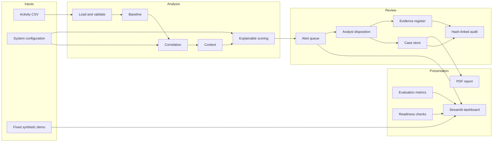

# System Architecture

## Purpose
A modular, defensive research prototype for analyzing **synthetic or approved activity records** and supporting human review of possible insider-risk indicators.

## Logical architecture

## Processing sequence
1. Read activity records and validate required fields.
2. Identify deviations from configured baselines.
3. Group related events using a bounded correlation window.
4. enrich event groups with available contextual signals.
5. calculate a score and retain the reasons that contributed to it.
6. present alert candidates to a human analyst.
7. record review decisions, cases, evidence references, and supported audit events.
8. display aggregate metrics and export a report where enabled.

## Trust boundaries
- **Input boundary:** use synthetic data or data explicitly approved for the study; validate file contents.
- **Analyst boundary:** authenticated roles determine access to review and administration functions.
- **Persistence boundary:** cases, configuration, evidence references, and audit records are stored locally by this prototype.
- **Export boundary:** reports may contain investigation details; handle them as sensitive and share only with authorized recipients.

## Design principles
- Explain scores rather than presenting unexplained labels.
- Keep automated flags separate from human conclusions.
- Prefer data minimization and controlled access.
- Keep the guided demonstration reproducible and separate from persistent case data.
- Describe evaluation results only within the limits of the synthetic dataset.

## Prototype limitations
This diagram describes logical modules, not a production deployment topology. Local files and a local dashboard do not provide enterprise-grade availability, centralized secure logging, hardened secrets management, or guaranteed tamper resistance.
