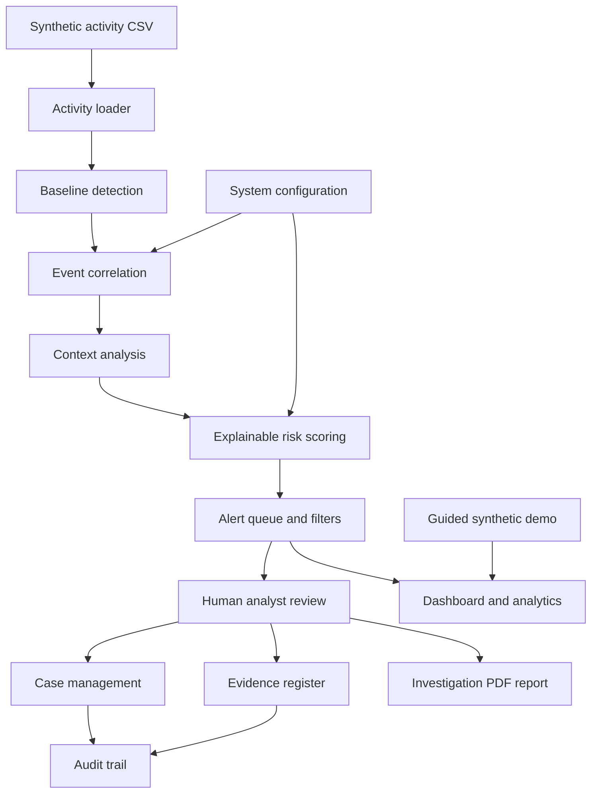

# Project Demonstration & Defense Guide

## Project title
**Insider Threats in Organizations: Causes, Warning Signs, and Risk Management**

## 1. Project overview
This project is a defensive, educational insider-threat risk-monitoring prototype. It analyzes **synthetic activity records** to identify unusual patterns, combine related events, explain risk scores, and present alerts for a human analyst to review.

It is a decision-support simulation—not an autonomous disciplinary tool, employee surveillance product, or production security platform.

## 2. Problem statement
Insider-related incidents can involve legitimate accounts being used in ways that conflict with normal work patterns. Reviewing isolated events manually may make related warning signs difficult to recognize. Organizations need a structured way to correlate activity, consider context, prioritize review, and document decisions while protecting privacy and avoiding unsupported conclusions.

## 3. Aim and objectives
**Aim:** Demonstrate a transparent workflow for identifying and reviewing potential insider-risk indicators in a controlled environment.

Objectives:
- Generate or load synthetic activity records.
- Establish baseline behavior and flag deviations.
- Correlate related events into activity sequences.
- Add contextual information to event interpretation.
- Produce explainable risk scores and alert reasons.
- Support analyst review, case tracking, evidence notes, and audit history.
- Evaluate the prototype using clearly labeled synthetic examples.
- Demonstrate ethical safeguards and limitations.

## 4. Architecture and data flow

### Main components
- **Activity loader / baseline detection:** reads the supplied activity data and establishes reference patterns.
- **Correlation:** groups related records within a configured time window.
- **Context analysis:** considers event attributes and approved context before scoring.
- **Risk engine:** produces a score, risk band, and human-readable reasons.
- **Alert management:** displays, filters, and tracks alerts and analyst dispositions.
- **Case management:** stores investigation status and history.
- **Evidence register:** records evidence references and notes for a case.
- **Audit trail:** maintains a tamper-evident hash-linked record of supported actions.
- **Evaluation dashboard:** reports metrics from the project's labeled synthetic evaluation set.
- **Guided demo:** walks through a fixed synthetic scenario without changing persistent case records.
- **System health:** checks local project dependencies and data-file readiness.

## 5. Demonstration workflow
1. Start the dashboard and sign in using the configured local analyst account.
2. Open **Project demonstration • Guided synthetic scenario**.
3. Select **Run guided demonstration**.
4. Review the synthetic event sequence and correlated activity.
5. Read the context and the score's explanation/reasons.
6. Open the regular alert area and demonstrate filtering or analyst review.
7. If demonstrating a case, show its status/history and evidence references.
8. Open system health and explain what its checks mean.
9. Finish by discussing evaluation results and limitations.

Use only the included synthetic scenario or data that has been explicitly approved for the demonstration. Do not use real employee records.

## 6. Evaluation and interpretation
The evaluation module compares model outputs with labels in a small, hand-labeled **synthetic** dataset. Explain the following metrics in plain language:
- **Precision:** among alerts marked positive, how many match the positive labels?
- **Recall:** among labeled positive examples, how many were detected?
- **F1 score:** a combined measure of precision and recall.
- **Confusion matrix:** counts of true positives, false positives, true negatives, and false negatives.

These results show behavior on the test examples only. They do **not** establish real-world accuracy, generalization, or readiness for deployment. A small synthetic dataset can be biased or unrepresentative; thresholds and labels influence results.

## 7. Ethical, privacy, and operational safeguards
- Use synthetic or expressly authorized data only.
- Treat an alert as a lead for review—not proof of misconduct.
- Require a trained human reviewer before any consequential action.
- Apply least privilege and role-based access to records.
- Minimize data collection and retention; protect exported reports.
- Document assumptions, score explanations, and analyst decisions.
- Provide a way to correct context and challenge inaccurate records.
- Avoid profiling protected characteristics or using personal attributes unrelated to work.
- Test for false positives and unequal impact before any real deployment.
- Follow organizational policy and applicable law.

## 8. Limitations
- The project is a student research prototype, not a production SIEM or endpoint agent.
- The demo and evaluation records are synthetic.
- Rule-based or threshold-based scores can produce false positives and false negatives.
- Behavior changes may have legitimate explanations (role changes, urgent work, travel, or approved tasks).
- Results depend on input quality, configuration, and labels.
- Hash-linked audit records can help reveal modification but do not alone guarantee secure storage or prevent every attack.
- No score should be interpreted as a statement about an employee's intent.

## 9. Suggested presentation outline (10–12 slides)
1. Title and team
2. Background and problem statement
3. Aim and objectives
4. Insider-threat indicators and responsible interpretation
5. Proposed system and architecture
6. Data flow and detection pipeline
7. Explainable scoring and alert review
8. Case management, evidence, and audit trail
9. Guided demonstration screenshots/results
10. Evaluation metrics and findings
11. Ethics, privacy, limitations
12. Conclusion and future work

## 10. Defense questions and sample answers

**Why did you choose this topic?**  
Insider-risk indicators can be difficult to interpret when events are reviewed separately. This project demonstrates a structured, explainable workflow for prioritizing human review.

**Does a high score prove an insider threat?**  
No. It indicates that the observed synthetic activity matched configured risk indicators. A reviewer must examine context and possible benign explanations.

**Why use synthetic data?**  
It protects privacy, makes the demonstration reproducible, and allows controlled testing without collecting sensitive employee information.

**What is event correlation?**  
It links related events that occur within a defined time window, so a sequence can be reviewed as a whole rather than as isolated records.

**What is the purpose of explainability?**  
The analyst can see which indicators contributed to a score and can assess whether they are relevant or misleading.

**What do precision and recall tell you?**  
Precision describes alert reliability in the labeled test set; recall describes how many labeled positive examples were found. Neither metric alone proves deployment effectiveness.

**What would you improve next?**  
Use a larger, independently reviewed synthetic dataset; conduct structured usability testing; add stronger access controls and secure deployment practices; and evaluate false-positive impact before considering any operational use.

## 11. Conclusion
The prototype demonstrates how synthetic activity can pass through correlation, context analysis, explainable scoring, alert review, and case documentation. Its main contribution is a transparent educational workflow with human oversight—not a claim that software can determine employee intent.
